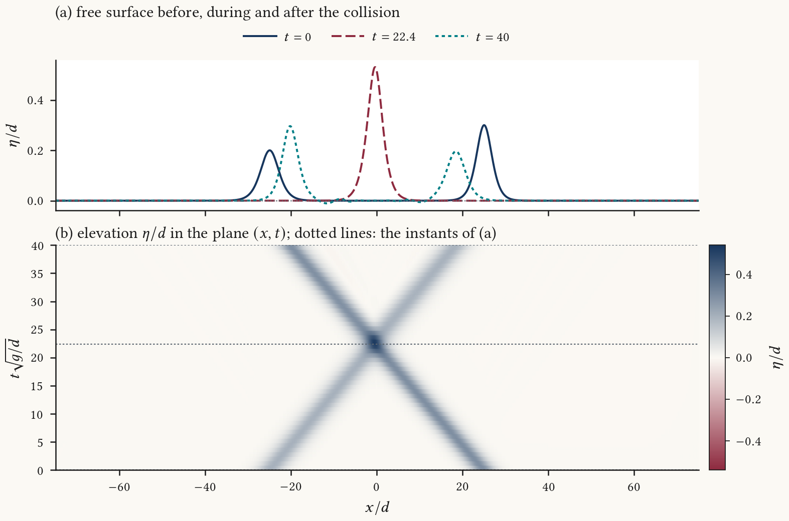

<!-- Author: Dr. Denys Dutykh (Mathematics Department, Khalifa University of Science and Technology, Abu Dhabi, UAE) -->

# SerreGravityWave: a Fourier pseudo-spectral solver for the Serre–Green–Naghdi equations of long gravity waves



The head-on collision of two solitary waves computed by `SerreGravityWave.m` with its own parameters: amplitudes
0.2 d and 0.3 d, centred at x = −25 d and x = 25 d, on the periodic interval −75 < x/d ⩽ 75 with 2048 Fourier modes,
up to t = 40 √(d/g). Panel (a) shows the free surface at t = 0, at t = 22.4, when the two crests merge into one of
height 0.530 d, and at t = 40: the waves emerge slightly lower, 0.296 d and 0.196 d, and leave a small dispersive tail
behind them (down to −0.0105 d), so that the collision is not perfectly elastic. Panel (b) shows the elevation in the
plane (x, t), on one colour scale from −0.54 (wine) to 0.54 (navy), from the 51 profiles that the function stores
every 0.8 time units; the dotted lines mark the instants of (a).

SerreGravityWave is a MATLAB function, which also runs unchanged in GNU Octave, that solves the Serre–Green–Naghdi
equations, the fully nonlinear and weakly dispersive model of long gravity waves in shallow water, over a flat bottom
on a periodic interval, and simulates as an example the head-on collision of two solitary waves. The fields are
expanded in Fourier series; the linear waves are propagated exactly in Fourier space, and the nonlinear terms are
advanced by a six-stage Runge–Kutta scheme of Dormand and Prince with a constant time step. The scheme is described
in the article of Denys Dutykh, Didier Clamond, Paul Milewski and Dimitrios Mitsotakis in the European Journal of
Applied Mathematics (2013), cited below.

## The problem

With the elevation η of the free surface, the total depth h = d + η and the depth-averaged horizontal velocity u, the
function solves the Serre–Green–Naghdi equations over a flat bottom, in the form

```text
η_t + (h u)_x = 0,
q_t + (q u − ½ u² − ½ h² u_x² + g h)_x = 0,        q = u − (h³ u_x)_x / (3h),
```

in units where g = d = 1, on the periodic interval −l < x ⩽ l. Their linear waves obey ω² = g d k² / (1 + d²k²/3), and
their solitary waves, of amplitude a and speed c, are

```text
η = a sech²( κ (x − x₀ − c t) / 2 ),     u = c η / h,     c = √(g (d + a)),     κ = √(3a / (d + a)) / d.
```

The initial condition is the sum of two such waves, of amplitude a1 = 0.2 centred at x = −25 and travelling to the
right, and of amplitude a2 = 0.3 centred at x = 25 and travelling to the left. The parameters are set at the top of
the function:

```text
l = 75, N = 2048                 half-length of the interval and number of Fourier modes
a1 = 0.2, a2 = 0.3               amplitudes of the two solitary waves
T = 40, M = 1000, m = 10         final time, number of time steps (dt = 0.04), drawing every m steps
tol = 1e-14, theta = 0.5         tolerance and relaxation of the iteration that recovers u from q
```

The unknowns η and q are advanced in Fourier space, where the linear part of the equations is integrated exactly
(an integrating factor) and the nonlinear part by the Runge–Kutta scheme; at each stage the velocity u is recovered
from q by a relaxed fixed-point iteration, and the products are computed on the grid. Against aliasing, every
wavenumber larger than N/4 in absolute value is removed from the fields and from the operators. The time step is
constant for simplicity; for other computations the authors recommend an adaptive time step, such as the PI control
of the step size.

## Quick start

From the folder `script/`, in MATLAB or GNU Octave:

```matlab
cd script
SerreGravityWave
```

The function takes no argument. Every 10 time steps it draws the free surface, the velocity and the Fourier spectrum
of η; at the end it draws the free surface in the plane (x, t) and the variation of the energy. The run takes about
forty seconds with GNU Octave 11.1.

## A check of the run

The equations conserve the energy

```text
E = ½ ∫ ( h u² + h³ u_x² / 3 + g η² ) dx,
```

which the function computes every 10 time steps. From E(0) = 0.4595461, it never departs by more than 1.5 × 10⁻⁵ (a
relative 3 × 10⁻⁵, reached during the collision, at t = 22.4), and it ends within 1.1 × 10⁻⁶ of its initial value.

## Contents

The folder `script/` holds the function `SerreGravityWave.m`; the picture `pics/SerreHeadOn.jpg` is the plot of the
free surface in the plane (x, t) that the function draws at the end of the run, shown by the first version of this
page. The folder `docs/figures/` holds the two scripts that make the figure of this page: `serre_readme_data.m`
(GNU Octave) runs the function as it stands and reads back the free surface and the energy from the figures that it
draws, and `plot_readme_figure.py` (Python 3 with NumPy and Matplotlib, and the style file beside it) draws them. Both
are run from `docs/figures/`, in this order.

## Requirements

MATLAB or GNU Octave (tested with Octave 11.1); no toolbox is needed.

## How to cite

If you use this code, please cite the article:

D. Dutykh, D. Clamond, P. Milewski and D. Mitsotakis, Finite volume and pseudo-spectral schemes for the fully nonlinear
1D Serre equations, European Journal of Applied Mathematics 24, 761–787 (2013).

https://doi.org/10.1017/S0956792513000168

```bibtex
@article{Dutykh2011a,
  author = {Dutykh, Denys and Clamond, Didier and Milewski, Paul and Mitsotakis, Dimitrios},
  title = {Finite Volume and Pseudo-Spectral Schemes for the Fully Nonlinear {{1D Serre}} Equations},
  journal = {European Journal of Applied Mathematics},
  year = 2013,
  volume = {24},
  number = {05},
  pages = {761--787},
  doi = {10.1017/S0956792513000168},
  eprint = {1104.4456},
  archiveprefix = {arXiv}
}
```

The button "Cite this repository" in the right-hand column of this page gives the same reference, read from
`CITATION.cff`. Free copies of the article are on arXiv and HAL:

https://arxiv.org/abs/1104.4456

https://hal.science/hal-00587994/

## Licence

MIT licence (see `LICENSE`).

## Authors

Denys Dutykh (Mathematics Department, Khalifa University of Science and Technology, Abu Dhabi), Didier Clamond
(Université Côte d'Azur, Laboratoire J.A. Dieudonné, Nice) and Dimitrios Mitsotakis (Victoria University of
Wellington); Paul Milewski is a co-author of the article.

https://www.denys-dutykh.com/
